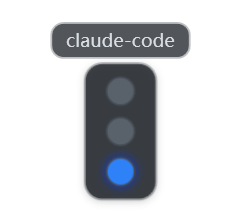
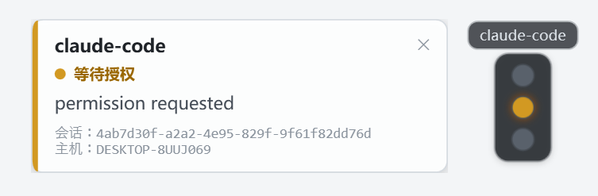
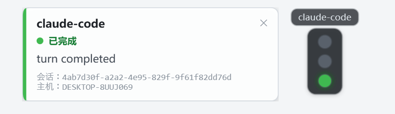
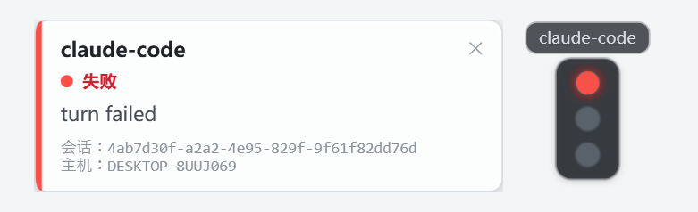
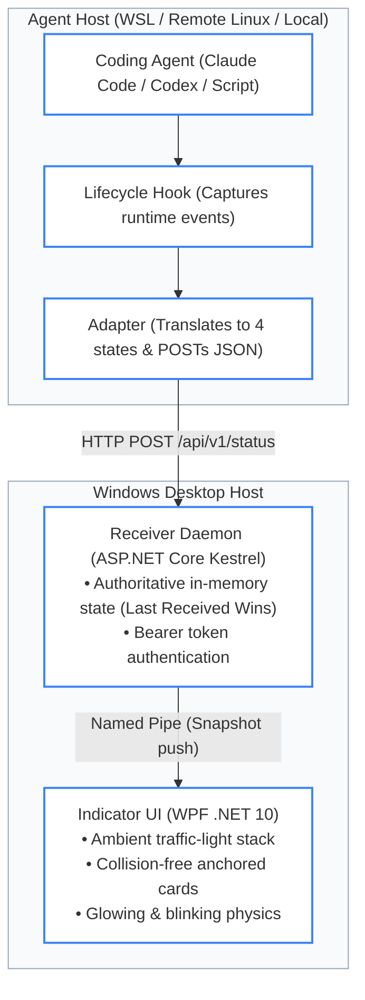

<div align="center">

# 🚥 AgentBeacon

**Ambient traffic-light status indicators for AI Coding Agents on Windows**

Stay in your flow. Glance at the top-right of your screen to track every agent session. No more Alt-Tab frenzy, no more missed approval prompts.

[English](README.en.md) • [简体中文](README.md) • [Architecture](docs/architecture.md) • [Protocol](docs/protocol.md) • [UI Policy](docs/ui-policy.md)

<p align="center">
  
  
  
  
  
  
</p>

</div>

---

## 💡 Why AgentBeacon?

When you run multiple **Claude Code** or **Codex CLI** sessions—especially on remote servers, WSL, or background containers—these scenarios happen all the time:

| The Everyday Pain | With AgentBeacon |
| :--- | :--- |
| 🔄 **Alt-Tab Fatigue**<br>A task has been running for 5 minutes. You keep switching back to the terminal every 30 seconds to check if it finished, breaking your concentration. | 🔵 **Steady Blue in Your Peripheral Vision**<br>Writing docs or in a meeting? A quick glance at the corner shows a steady blue light. It's working; relax. |
| ⏳ **Silent Permission Stalls**<br>An agent wants to run a bash command and is waiting for your `[y/N]` approval. Because you switched away, it hangs silently for 30 minutes. | 🟡 **Yellow Light Blinks & Card Slides Out**<br>As soon as approval is requested, a sleek card glides out with full context while the yellow light blinks. Impossible to miss. |
| 🚨 **Unnoticed Silent Crashes**<br>A network timeout or process crash happens early on. You only realize hours later that nothing got done. | 🔴 **Persistent Red Light with Direct Error Context**<br>The session turns red immediately and shows error details in a 30s notification card. Catch failures early, re-run immediately. |
| 🗂️ **Multi-Session Confusion**<br>Running 4 terminals doing different tasks? Hard to remember which session is refactoring and which is running tests. | 🏷️ **Dedicated Module per Session & Right-Click Rename**<br>Each session gets its own lamp. Right-click to rename it to "Refactor Auth" or "Fix Unit Tests". |

> **What is Ambient Awareness?**  
> Just like physical indicators on your keyboard or dashboard, AgentBeacon never steals focus and stays quietly in your peripheral vision, giving you instant confidence without disrupting your flow.

---

## 📸 Status System & Visual Experience

AgentBeacon renders an independent, realistic **three-light traffic module** for each agent session at the top-right corner of your desktop. It strictly maintains four clean, deterministic states:

| Lamp Position | Status Code | Color | Meaning | Notification Card Behavior |
| :---: | :---: | :---: | :--- | :--- |
| **Bottom** | `running` | 🔵 Blue (`#2F81F7`) | Agent is actively executing tasks / tools | **No card** (steady blue glow, preserving focus) |
| **Middle** | `approval` | 🟡 Yellow (`#D29922`) | Waiting for human permission / confirmation | **Card slides out for 30s**, yellow lamp blinks realistically then stays lit |
| **Bottom** | `completed` | 🟢 Green (`#3FB950`) | Current turn finished successfully | **Card slides out for 30s** with summary; light auto-closes after 20 mins |
| **Top** | `failed` | 🔴 Red (`#F85149`) | Task failed, uncaught error, or crash | **Card slides out for 30s** with error details; light auto-closes after 20 mins |

<br>

<table align="center">
  <tr>
    <td align="center" width="25%"><b>🔵 Running</b></td>
    <td align="center" width="75%"><b>🟡 Waiting for Approval</b></td>
  </tr>
  <tr>
    <td align="center"></td>
    <td align="center"></td>
  </tr>
  <tr>
    <td align="center" colspan="2"><b>🟢 Turn Completed</b></td>
  </tr>
  <tr>
    <td align="center" colspan="2"></td>
  </tr>
  <tr>
    <td align="center" colspan="2"><b>🔴 Session Failed</b></td>
  </tr>
  <tr>
    <td align="center" colspan="2"></td>
  </tr>
</table>

---

## ✨ Key Features

- 🎯 **Non-Intrusive Native Desktop UX**:
  - Built with native WPF and `WS_EX_NOACTIVATE`: **never steals window focus**.
  - Borderless, clean aesthetic. Does not clutter your taskbar or Alt-Tab switcher.
  - **Dynamic Auto-Hide**: When all sessions are closed or complete, the indicator window completely vanishes.
- 🖱️ **Thoughtful Desktop Interactions**:
  - **Free Dragging**: Left-drag any traffic light module to reposition the entire stack anywhere on your screen.
  - **Multi-Monitor & Mixed DPI**: Seamlessly handles negative coordinates, stacked screens, and DPI scaling.
  - **Right-Click Rename**: Right-click any module and select "Rename this light" to turn cryptic UUIDs into friendly names.
  - **Auto & Manual Dismissal**: Completed and failed lights automatically extinguish after 20 minutes (configurable), or dismiss instantly via right-click.
- 🔌 **Ready-to-Use Agent Adapters**:
  - **Claude Code**: First-class plugin utilizing official hooks (SessionStart, Pre/PostToolUse, PermissionRequest, SessionEnd).
  - **Codex CLI**: Native plugin integration mapping approvals and tool executions.
  - **Universal Protocol**: Integrate any custom agent, Aider, AutoGPT, or script with a single HTTP POST request in 30 seconds.
- 🛡️ **Robust, Decoupled Architecture**:
  - Complete process isolation between Windows Receiver and Indicator (via Named Pipe IPC). UI glitches never break status ingestion.
  - One-way, stateless reporting (Last Received Wins). Zero network deadlocks; zero interference with agent LLM inference.
  - Backed by 170+ rigorous automated tests across Linux and Windows native CI.

---

## ⚡ 1-Minute Quick Start

### Step 1: Install Windows Receiver & Indicator

#### Option A: Portable Pre-Built Package (Recommended)

1. Download the release package (or cross-build with `bash scripts/dist.sh --zip` inside WSL). The package is self-contained with the .NET runtime included—**no prerequisites needed on the target machine**.
2. Unpack it into a permanent folder (e.g., `C:\AgentBeacon`).
3. (Optional) Adjust `agentbeacon.json` if you wish to change port or add an auth token.
4. Double-click **`install.bat`**.
   > It configures autostart on login and launches the background receiver and indicator. (To uninstall, just run `uninstall.bat`).

#### Option B: Build from Source (Developer Mode)

In Windows PowerShell:

```powershell
git clone https://github.com/zinc/AgentBeacon.git
cd AgentBeacon
powershell -ExecutionPolicy Bypass -File scripts\windows\install.ps1
```

---

### Step 2: Connect Your Coding Agent

#### Method 1: Claude Code

In your terminal (pointing to this repo's root directory):

```bash
# Register repository as a local marketplace
claude plugin marketplace add /path/to/AgentBeacon
# Install AgentBeacon plugin
claude plugin install agentbeacon@agentbeacon
```

#### Method 2: Codex CLI

```bash
# Add marketplace
codex plugin marketplace add /path/to/AgentBeacon
# Install Codex plugin
codex plugin add agentbeacon-codex@agentbeacon
```
> *Note: Open `codex` and run `/hooks` to trust the AgentBeacon entries upon first install.*

#### Method 3: Any Custom Agent or Script (1 cURL Request)

Any tool that can send an HTTP POST can report status directly:

```bash
# Report running
curl -X POST http://127.0.0.1:8765/api/v1/status \
  -H "Content-Type: application/json" \
  -d '{"session_id": "task-01", "agent": "MyAgent", "status": "running"}'

# Request approval (slides out notification card)
curl -X POST http://127.0.0.1:8765/api/v1/status \
  -H "Content-Type: application/json" \
  -d '{"session_id": "task-01", "agent": "MyAgent", "status": "approval", "message": "Executing dangerous command: rm -rf dist/"}'
```

---

### Step 3: Verification & Smoke Test

A ready-to-run smoke test script is included:

```bash
AGENTBEACON_URL=http://127.0.0.1:8765 AGENTBEACON_TOKEN="" bash examples/smoke_curl.sh
```

Watch the top-right corner cycle through: **Blue on ➔ Yellow blinking with approval card ➔ Blue back ➔ Green with completion card**!

---

## 🛠️ Configuration

### Windows Host (`agentbeacon.json`)

Located in your installation folder (see [agentbeacon.example.json](agentbeacon.example.json)):

```json
{
  "bind": "0.0.0.0",
  "port": 8765,
  "token": "",
  "indicator_lamp_auto_close_minutes": 20
}
```

| Field | Default | Description |
| :--- | :---: | :--- |
| `bind` | `"0.0.0.0"` | Binding address. Use `127.0.0.1` for local-only, or `0.0.0.0` for remote/WSL access. |
| `port` | `8765` | Receiver HTTP listening port. |
| `token` | `""` | Auth token. Empty string = no authentication. When set, requests require `Authorization: Bearer <token>`. |
| `indicator_lamp_auto_close_minutes` | `20` | Duration (minutes) after which `completed` and `failed` lamps automatically disappear. |

### Agent Client (`~/.agentbeacon.json`)

Both adapters read this configuration from the user's home directory:

```json
{
  "url": "http://127.0.0.1:8765",
  "token": null
}
```

---

## 🏗️ Architecture & How It Works



1. **Zero Inference Interference**: Hooks simply send a one-way HTTP POST during lifecycle transitions. Zero LLM overhead.
2. **Minimalist Protocol**: A single `POST /api/v1/status` endpoint. No complicated bi-directional handshakes or retry storms.
3. **Decoupled Architecture**: Receiver ingests network events; Indicator displays the UI. The Indicator process can crash or reload without losing received status.

---

## ❓ Frequently Asked Questions (FAQ)

<details>
<summary><b>Q1: Does AgentBeacon work with WSL2 or remote dev servers?</b></summary>
<br>
<b>Yes, seamlessly!</b><br>
Your agent only needs network access to the Windows Receiver:
- <b>WSL2</b>: You can use <code>http://127.0.0.1:8765</code> directly via WSL2's localhost forwarding or the host gateway IP.
- <b>Remote Linux / Cloud Devbox</b>: Set <code>bind: "0.0.0.0"</code> and configure a shared <code>token</code> in Windows <code>agentbeacon.json</code>. Put the Windows IP and token into your remote machine's <code>~/.agentbeacon.json</code>.
</details>

<details>
<summary><b>Q2: Why not a Web dashboard or mobile push notifications?</b></summary>
<br>
Web dashboards require active tab-switching and manual polling, defeating the purpose of staying in the flow. Mobile push notifications quickly lead to <b>notification fatigue</b> for continuous agent steps.<br><br>
AgentBeacon offers <b>true ambient computing</b>: like hardware LEDs or dashboard indicators, it requires no active cognitive effort until you need it.
</details>

<details>
<summary><b>Q3: Does AgentBeacon inspect my source code or hijack prompts?</b></summary>
<br>
<b>Never.</b> AgentBeacon is 100% open-source and strictly reports state metadata (<code>session_id</code>, <code>agent</code>, <code>status</code>, and brief message headers). It has zero access to your code files or model context.
</details>

---

## 🗺️ Roadmap

- [x] Claude Code official hooks & plugin adapter
- [x] Codex CLI plugin adapter
- [x] Realistic physical traffic lights, glow, and smooth animations
- [x] Multi-monitor and dynamic DPI collision avoidance
- [x] Automatic timeout dismiss and right-click rename
- [ ] Additional agent adapters (OpenCode, Aider, Cursor CLI)
- [ ] Diagnostic CLI tool (`agentbeacon doctor`)
- [ ] macOS menu bar & Linux system tray ambient indicator

---

## 🤝 Contributing

Contributions, issues, and feature requests are very welcome!

- Read [docs/architecture.md](docs/architecture.md) for system design details.
- Read [docs/protocol.md](docs/protocol.md) for API contract & adapter writing.
- Read [docs/ui-policy.md](docs/ui-policy.md) for desktop UI interaction guidelines.

---

## 📄 License

Distributed under the [Apache-2.0](LICENSE) License.

<div align="center">
  <sub>Built with ❤️ for AI Agent Developers. If AgentBeacon saves your focus, give it a ⭐️!</sub>
</div>
