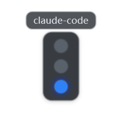
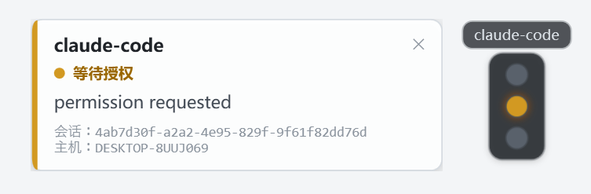
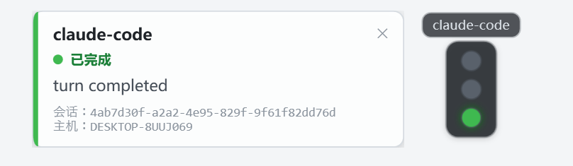
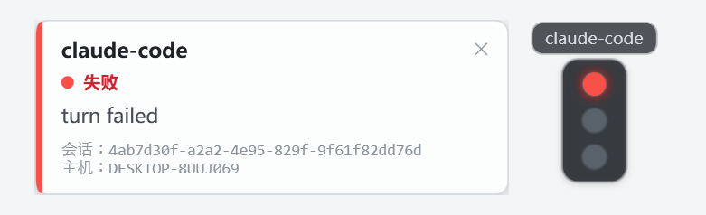
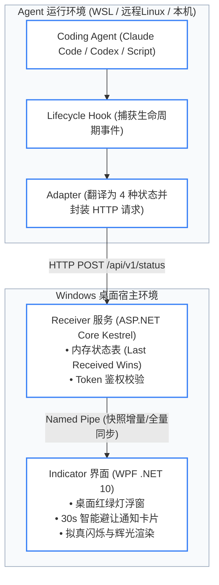

<div align="center">

# 🚥 AgentBeacon

**专为 AI Coding Agents 打造的 Windows 桌面「环境态红绿灯」指示器**

余光扫一眼，掌控所有 Agent 会话状态。告别频繁切屏，告别无休止等待。

[简体中文](README.md) • [English](README.en.md) • [架构设计](docs/architecture.md) • [协议规范](docs/protocol.md) • [UI 规范](docs/ui-policy.md)

<p align="center">
  
  
  
  
  
  
</p>

</div>

---

## 💡 为什么需要 AgentBeacon？

当你同时运行多个 **Claude Code**、**Codex CLI**，或者把 Agent 跑在远程开发机、WSL 与后台容器中时，这些让人抓狂的场景是否频繁发生：

| 传统痛点 | 开了 AgentBeacon 之后 |
| :--- | :--- |
| 🔄 **频繁 Alt-Tab 切终端**<br>任务跑了几分钟，不敢确定到底跑完没，隔几十秒就切屏看一眼，心流全碎。 | 🔵 **余光一瞥，蓝灯正在常亮**<br>在写文档或开会？瞥一眼屏幕右上角，蓝灯亮着代表正在执行，安心继续手头工作。 |
| ⏳ **授权等待无人知晓**<br>Agent 遇到敏感 Bash 命令需要回车确认权限，由于你切走了终端，它静默卡了半小时。 | 🟡 **黄灯闪烁，卡片优雅滑出**<br>一旦触发审批，左侧卡片携带审批上下文滑出并闪烁黄灯，哪怕戴耳机听歌也能立刻捕获。 |
| 🚨 **异常崩溃浑然不觉**<br>网络超时、进程挂掉或者上下文超限报错，过去几个小时后你才发现早就中断了。 | 🔴 **红灯常亮，错误原因直观呈现**<br>会话异常终止即刻亮红灯，30 秒卡片直陈报错详情，早发现、早重试。 |
| 🗂️ **多 Agent 会话混乱**<br>开了好几个终端跑不同模块，弄不清哪一个是重构、哪一个是写单测。 | 🏷️ **独立灯柱，右键一键重命名**<br>每个 Session 独占一盏灯，右键直接改名为「重构用户模块」，清晰有条理。 |

> **什么是环境态感知 (Ambient Awareness)？**  
> 它就像办公室走廊的安全指示灯：平时安静无声绝不抢前台焦点，无需刻意关注；但当状态有变时，你的视觉余光可以在 0.1 秒内瞬间捕获。

---

## 📸 状态体系与视觉呈现

AgentBeacon 为每个 Agent 会话在屏幕右上角提供一个独立的**拟真三灯模块**。全局严格维持四种明确状态，杜绝冗余模糊状态：

| 物理灯位 | 状态代码 | 视觉颜色 | 含义说明 | 桌面通知卡片行为 |
| :---: | :---: | :---: | :--- | :--- |
| **底部** | `running` | 🔵 蓝色 (`#2F81F7`) | Agent 正在处理任务与执行命令 | **不弹卡片**，蓝灯平稳常亮，杜绝打扰心流 |
| **中间** | `approval` | 🟡 黄色 (`#D29922`) | Agent 正在等待人工授权批准 (Permission) | **卡片向左滑出 30 秒**，黄灯拟真闪烁后持续常亮 |
| **底部** | `completed` | 🟢 绿色 (`#3FB950`) | 当前轮次任务执行完毕 | **卡片滑出 30 秒**展示完成摘要，绿灯保持，20分钟后自动关灯 |
| **顶部** | `failed` | 🔴 红色 (`#F85149`) | 任务失败、未捕获异常或进程非正常退出 | **卡片滑出 30 秒**展示错误信息，红灯保持，20分钟后自动关灯 |

<br>

<table align="center">
  <tr>
    <td align="center" width="25%"><b>🔵 任务执行中 (running)</b></td>
    <td align="center" width="75%"><b>🟡 等待人工授权 (approval)</b></td>
  </tr>
  <tr>
    <td align="center"></td>
    <td align="center"></td>
  </tr>
  <tr>
    <td align="center" colspan="2"><b>🟢 任务完成 (completed)</b></td>
  </tr>
  <tr>
    <td align="center" colspan="2"></td>
  </tr>
  <tr>
    <td align="center" colspan="2"><b>🔴 异常失败 (failed)</b></td>
  </tr>
  <tr>
    <td align="center" colspan="2"></td>
  </tr>
</table>

---

## ✨ 核心特性

- 🎯 **零侵入原生体验**：
  - 基于 WPF 原生打造，采用 `WS_EX_NOACTIVATE` 属性，**绝不抢占当前窗口焦点**。
  - 无边框极简浮窗，不进任务栏，不污染 Alt-Tab 窗口列表。
  - **动态自适应**：无活跃会话或灯全部关闭时，窗口**自动完全隐藏**，零桌面杂乱。
- 🖱️ **贴心的桌面交互**：
  - **自由拖拽**：鼠标左键按住任意红绿灯，即可自由拖动整列灯柱停靠到合适位置。
  - **多屏自适应**：完美支持跨显示器、负坐标屏幕与混合 DPI 高分屏环境。
  - **右键别名**：右键点击红绿灯选择「重命名此灯」，给复杂的 UUID 会话起一个亲切的名字。
  - **手动/自动收纳**：已完成或失败的灯默认在 20 分钟后自动熄灭关闭；随时可右键「关闭此灯」立即关闭。
- 🔌 **主流 Coding Agent 开箱即用**：
  - **Claude Code**：内置官方 Hooks / Plugin 架构深度适配，完整覆盖权限请求与生命周期。
  - **Codex CLI**：一键安装 Codex 扩展插件，精确监听 ToolUse 与 Approval 事件。
  - **通用极简协议**：仅需一个 HTTP POST 请求，30 秒集成任意脚本、Aider、AutoGPT 或私有 Agent。
- 🛡️ **健壮解耦的工程架构**：
  - Windows Receiver 与 Indicator 进程彻底隔离（通过 Named Pipe 传输快照），UI 渲染崩溃不影响状态接收。
  - 单向无状态上报机制（Last Received Wins），无网络死锁，不干涉 Agent 本身的模型推理。
  - 内置 170+ 项严苛自动化测试（Linux & Windows 双平台 CI 校验）。

---

## ⚡ 1 分钟快速上手

### 第 1 步：安装 Windows 接收与指示端 (Receiver & Indicator)

#### 方案 A：开箱即用免编译包（推荐）

1. 下载最新发布包（或在 WSL 运行 `bash scripts/dist.sh --zip` 产出自包含发布包，包内自带 .NET 运行时，**无需目标机器预装任何依赖**）。
2. 解压到本地稳定目录（如 `C:\AgentBeacon`）。
3. （可选）编辑 `agentbeacon.json` 自定义端口或访问 Token。
4. 双击运行 **`install.bat`**。
   > 脚本将自动配置后台服务并注入开机启动，桌面右上角进入守候状态。（若需卸载，双击 `uninstall.bat` 即可一键清理）。

#### 方案 B：从源码编译构建（开发者模式）

在 Windows PowerShell 中执行：

```powershell
git clone https://github.com/zinc/AgentBeacon.git
cd AgentBeacon
powershell -ExecutionPolicy Bypass -File scripts\windows\install.ps1
```

---

### 第 2 步：接入你的 Coding Agent

#### 方式 1：Claude Code 接入

在终端中执行（指向本仓库根目录）：

```bash
# 添加本地或远程 marketplace
claude plugin marketplace add /path/to/AgentBeacon
# 安装 AgentBeacon 插件
claude plugin install agentbeacon@agentbeacon
```

#### 方式 2：Codex CLI 接入

```bash
# 添加插件市场
codex plugin marketplace add /path/to/AgentBeacon
# 安装 Codex 专属插件
codex plugin add agentbeacon-codex@agentbeacon
```
> *注：首次安装后进入 `codex` 执行 `/hooks`，将 AgentBeacon 标记为信任即可。*

#### 方式 3：任意自定义 Agent / 脚本（1 行 cURL 接入）

无论是 Python 脚本、Bash 自动化、还是自定义 Agent，只要能发送 HTTP POST 即可极速接入：

```bash
# 发送 running 状态
curl -X POST http://127.0.0.1:8765/api/v1/status \
  -H "Content-Type: application/json" \
  -d '{"session_id": "task-01", "agent": "MyAgent", "status": "running"}'

# 请求人工授权（弹卡片提示）
curl -X POST http://127.0.0.1:8765/api/v1/status \
  -H "Content-Type: application/json" \
  -d '{"session_id": "task-01", "agent": "MyAgent", "status": "approval", "message": "正在请求执行: rm -rf dist/"}'
```

---

### 第 3 步：验证与冒烟测试

仓库内准备了即开即用的冒烟验证脚本：

```bash
AGENTBEACON_URL=http://127.0.0.1:8765 AGENTBEACON_TOKEN="" bash examples/smoke_curl.sh
```

执行后，你的屏幕右上角将依次体验：**蓝灯亮起 ➔ 黄灯闪烁并滑出授权卡片 ➔ 蓝灯恢复 ➔ 绿灯亮起并通知任务完成**！

---

## 🛠️ 配置说明

### Windows 端配置 (`agentbeacon.json`)

配置文件位于安装目录下（可参考 [agentbeacon.example.json](agentbeacon.example.json)）：

```json
{
  "bind": "0.0.0.0",
  "port": 8765,
  "token": "",
  "indicator_lamp_auto_close_minutes": 20
}
```

| 配置项 | 默认值 | 作用说明 |
| :--- | :---: | :--- |
| `bind` | `"0.0.0.0"` | 监听地址。仅本机（含本机 WSL）使用可设为 `127.0.0.1`；跨机器使用保持 `0.0.0.0`。 |
| `port` | `8765` | Receiver HTTP 服务监听端口。 |
| `token` | `""` | 鉴权令牌。留空为免密；设置后请求头需携带 `Authorization: Bearer <token>`。 |
| `indicator_lamp_auto_close_minutes` | `20` | 绿灯 (completed) 与红灯 (failed) 保持同一状态后**自动熄灭移除**的时长（分钟）。 |

### Agent 客户端配置 (`~/.agentbeacon.json`)

Agent 端统一读取用户主目录下的配置文件：

```json
{
  "url": "http://127.0.0.1:8765",
  "token": null
}
```

> **安全提示**：若将 `bind` 设为 `0.0.0.0` 并暴露到公网或未受信局域网，请务必设置非空 `token` 以防恶意灌入状态伪造通知。

---

## 🏗️ 架构与工作原理

AgentBeacon 遵循 **“最小干预、职责隔离”** 的工业级设计理念：



1. **零性能开销**：Hook 脚本只在生命周期转换时触发一次轻量 HTTP POST，不占用模型推理时间。
2. **极简协议契约**：服务端仅暴露单向 `POST /api/v1/status`，不搞双向长连接重试，杜绝旧状态覆盖新状态。
3. **高内聚解耦**：Receiver 负责网络监听与快照维护；Indicator 负责纯粹的 Windows 桌面渲染与交互。两者互为独立进程，Indicator 关闭或重载完全不影响状态接收。

---

## 💻 桌面交互小技巧

- 📍 **调整停靠位置**：鼠标左键长按任意指示灯模块，随心拖动至屏幕任意顺眼角落。
- ✏️ **重命名会话**：右键点击指示灯 ➔「重命名此灯」，输入如「用户模块重构」，告别无意义的 UUID。
- 🔕 **手动提前清理**：右键点击指示灯 ➔「关闭此灯」，立即清理已处理完毕的会话。
- ❌ **提前关闭卡片**：滑出的通知卡片右上角设有 `✕` 按钮，点击即可提前收回。
- 🖥️ **跨屏与高分屏支持**：无论你的显示器位于左侧负坐标、主副屏上下错位还是 DPI 缩放不一致，卡片与灯柱均能平滑自适应。

---

## ❓ 常见问题 (FAQ)

<details>
<summary><b>Q1: AgentBeacon 支持在 WSL、远程开发机或者 Docker 中使用吗？</b></summary>
<br>
<b>完全支持！</b><br>
Agent 侧只需要能通过网络访问 Windows 宿主机的 IP 和端口即可：
- <b>WSL2 环境</b>：默认可以直接使用 <code>http://127.0.0.1:8765</code>，或者通过 WSL 的宿主网关 IP 通信。
- <b>远程云主机 / 局域网</b>：在 Windows <code>agentbeacon.json</code> 中配置 <code>bind: "0.0.0.0"</code> 并设置 <code>token</code>，远程主机 <code>~/.agentbeacon.json</code> 中填写 Windows 主机的局域网/公网 IP 和相应 token 即可。
</details>

<details>
<summary><b>Q2: 为什么不做成传统的 Web 控制台或手机推送？</b></summary>
<br>
Web 控制台需要你额外开一个浏览器标签并主动刷新查看，本质上没有解决「切屏打断心流」的问题；而手机推送对频繁的 Agent 动作会造成严重的<b>通知疲劳 (Notification Fatigue)</b>。<br><br>
AgentBeacon 追求的是<b>物理级环境态 (Ambient Status)</b>——就像机械键盘上的指示灯或汽车仪表盘，不需要特意去看它，但它永远在视线余光内提供安心反馈。
</details>

<details>
<summary><b>Q3: AgentBeacon 会不会偷看我的代码或拦截 Agent 决策？</b></summary>
<br>
<b>绝不会。</b> AgentBeacon 是 100% 开源的单向指示系统：
- 协议仅包含 <code>session_id</code>、<code>agent</code>、<code>status</code>、<code>message</code> 等元数据。
- 不读取任何代码文件内容，不参与模型的上下文推理，不提供任何反向控制指令。
</details>

---

## 🗺️ 路线图 (Roadmap)

- [x] 支持 Claude Code 官方 Hooks 适配
- [x] 支持 Codex CLI 插件适配
- [x] 拟真物理红绿灯、发光与平滑过渡动画
- [x] 多显示器与动态 DPI 避让计算
- [x] 自动超时关灯与手动重命名
- [ ] 更多 Coding Agent 适配（OpenCode、Aider、Cursor 自动化）
- [ ] 状态上报排查诊断 CLI (`agentbeacon doctor`)
- [ ] macOS 菜单栏 / Linux 托盘环境态指示器适配

---

## 🤝 参与贡献

热烈欢迎提交 Issue 与 Pull Request！

- 查看 [docs/architecture.md](docs/architecture.md) 了解系统架构设计
- 查看 [docs/protocol.md](docs/protocol.md) 了解协议与扩展新 Agent 的规范
- 查看 [docs/wsl中开发时的调试说明.md](docs/wsl中开发时的调试说明.md) 了解本地开发调试指南

---

## 📄 开源许可证

本项目采用 [Apache-2.0](LICENSE) 开源许可证。

<div align="center">
  <sub>Made with ❤️ for AI Agent Developers. If AgentBeacon helps your flow, give it a ⭐️!</sub>
</div>
